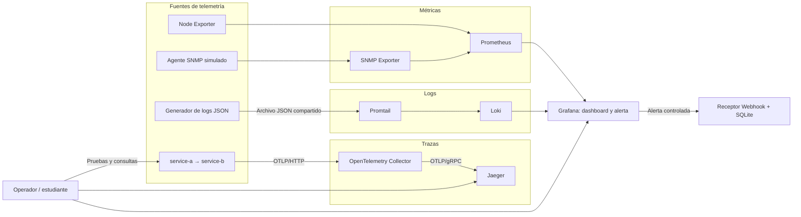

# Stack de Observabilidad — Infraestructura TI

Laboratorio académico de **observabilidad local con Docker Compose**. Reúne métricas de infraestructura y red, registros JSON centralizados, visualización y alertas, y trazas distribuidas entre microservicios. El propósito es demostrar cómo detectar, investigar y documentar el comportamiento de un sistema mediante señales complementarias, con pruebas reproducibles y evidencias verificables.

El stack está compuesto por **13 servicios** y funciona en Windows con Docker Desktop y contenedores Linux. No requiere servicios cloud ni instalar Python en el equipo anfitrión: las aplicaciones y herramientas de validación se ejecutan en contenedores. El alcance y las evidencias de las pruebas realizadas se encuentran en el [informe técnico](docs/INFORME.md) y en [docs/evidence/](docs/evidence/README.md).

## ¿Qué observa el proyecto?

| Señal | Origen y recorrido | Qué permite comprobar |
|---|---|---|
| **Métricas** | Node Exporter y agente SNMP simulado → SNMP Exporter / Prometheus | CPU, almacenamiento y contadores de red mediante PromQL |
| **Logs** | Generador JSON → volumen compartido → Promtail → Loki | Ingesta de eventos y búsqueda por severidad con LogQL |
| **Visualización y alertas** | Prometheus y Loki → Grafana → receptor Webhook | Dashboard operativo, regla de CPU y avisos `firing` / `resolved` almacenados en SQLite |
| **Trazas** | `service-a` → `service-b` → SDK OpenTelemetry → Collector → Jaeger | Relaciones padre-hijo, duración de spans y localización de la operación más lenta |

> **Alcance:** Node Exporter mide el entorno Linux que ejecuta Docker Desktop, no el sistema Windows anfitrión. El agente SNMP, los eventos cloud y las esperas de la aplicación son simulaciones de laboratorio; la recolección, comunicación entre servicios, exportación y consultas se ejecutan realmente. Jaeger usa almacenamiento en memoria, por lo que las trazas activas no sobreviven a su reinicio.

## Arquitectura funcional



El flujo se divide en tres canales de telemetría. Grafana consulta métricas y logs; Jaeger permite explorar trazas distribuidas. Las pruebas de integración comprueban estos canales y verifican que la alerta de CPU vuelva a su configuración normal después del ensayo controlado.

## Estructura del repositorio

```text
.
├── README.md                    # Guía principal
├── docker-compose.yml           # Orquestación de los 13 servicios
├── dev.ps1                      # Comandos de desarrollo y validación
├── .env.example                 # Variables locales de ejemplo
├── app/                         # Microservicios A/B y telemetría OpenTelemetry
│   ├── service-a/
│   ├── service-b/
│   └── shared/
├── configs/                     # Configuración de Prometheus, SNMP, Loki,
│   ├── prometheus/              # Promtail, Collector y Jaeger
│   ├── snmp-exporter/
│   ├── loki/
│   ├── promtail/
│   ├── otel-collector/
│   └── jaeger/
├── dashboards/                  # Dashboard, fuentes de datos y alertas Grafana
│   ├── dashboards/
│   ├── provisioning/
│   └── alerting/
├── simulators/                  # Agente SNMP y generador de logs JSON
│   ├── snmp-agent/
│   └── cloud-logs/
├── tools/                       # Receptor Webhook y comprobaciones auxiliares
│   └── webhook-receiver/
├── tests/                       # Pruebas de validación e integración
│   ├── validation/
│   └── integration/
└── docs/                        # Informe, documentación por etapa y evidencias
    ├── README.md
    ├── INFORME.md
    ├── PR03.md
    ├── PR04.md
    ├── PR05.md
    ├── architecture/
    ├── references/
    └── evidence/
        ├── README.md
        ├── pr-02/
        ├── pr-03/
        ├── pr-04/
        └── pr-05/
```

Las carpetas `docs/architecture/` y `docs/references/` están reservadas para material complementario. Las capturas y resultados efectivamente registrados se organizan en `docs/evidence/pr-XX/`, separados en `screenshots/` y `results/` cuando corresponde.

## Requisitos

- **Windows 10/11** con Docker Desktop iniciado, usando **contenedores Linux** (WSL 2 en la configuración documentada).
- **Docker Engine y Docker Compose v2**, accesibles desde la terminal como `docker` y `docker compose`.
- **Windows PowerShell 5.1 o PowerShell 7**, para ejecutar `dev.ps1`.
- **Git**, para clonar y versionar el proyecto.
- Recursos suficientes para iniciar 13 contenedores y puertos locales disponibles: `3000`, `8081`, `8082`, `9090`, `9100`, `9116`, `3100`, `9080`, `16686`, `4317`, `4318` y `13133`.

No es necesario instalar Python en Windows ni disponer de credenciales de proveedores externos. Las credenciales predeterminadas de Grafana son **solo para uso local de laboratorio**; no expongas este stack directamente a Internet.

## Instalación y ejecución paso a paso

Abre PowerShell y ejecuta los comandos desde la raíz del repositorio.

**1. Comprueba los requisitos:**

```powershell
docker --version
docker compose version
docker info
git --version
$PSVersionTable.PSVersion
```

`docker info` debe poder comunicarse con Docker Desktop. Si falla, abre Docker Desktop y espera a que el motor esté disponible.

**2. Clona el repositorio y entra en él:**

```powershell
git clone https://github.com/CTorrejon1995/PTEC104-8571-TALLER-OBSERVABILIDAD.git
Set-Location .\PTEC104-8571-TALLER-OBSERVABILIDAD
```

**3. Crea la configuración local:**

```powershell
if (-not (Test-Path .env)) { Copy-Item .env.example .env }
```

Revisa `.env` si necesitas cambiar el nombre del proyecto o las credenciales locales de Grafana. No publiques contraseñas reales en Git.

**4. Valida y levanta el entorno:**

```powershell
.\dev.ps1 validate
.\dev.ps1 up -Build
.\dev.ps1 status
```

`validate` comprueba el modelo Compose y las configuraciones. `up -Build` prepara las imágenes locales cuando hace falta y levanta los servicios en segundo plano. `status` permite revisar el estado de los contenedores. En el stack completo se esperan **13 servicios configurados**.

Si PowerShell bloquea la ejecución de scripts, puedes habilitarlos únicamente en esa sesión y volver a intentarlo:

```powershell
Set-ExecutionPolicy -Scope Process -ExecutionPolicy RemoteSigned
```

**5. Ejecuta las pruebas:**

```powershell
.\dev.ps1 test
.\dev.ps1 test -Integration
```

La prueba estática revisa las configuraciones. La integración requiere que el stack esté iniciado y comprueba métricas, logs, Grafana/Webhook y trazas distribuidas. La prueba de alertas usa temporalmente un umbral controlado y después restaura la regla normal de **CPU > 80 % durante 1 minuto**. Las pruebas pueden generar nuevos resultados en `docs/evidence/`.

**6. Explora los resultados:** abre Grafana, consulta las métricas en Prometheus, revisa eventos en Loki y genera solicitudes de prueba desde la aplicación para inspeccionar trazas en Jaeger. Consulta los accesos de la tabla siguiente.

**7. Detén el laboratorio al terminar:**

```powershell
.\dev.ps1 down
```

Este comando conserva los volúmenes. Evita `clean` si quieres mantener métricas, logs y avisos guardados.

## Comandos de administración

| Comando | Responsabilidad |
|---|---|
| `.\dev.ps1 validate` | Verificar Compose y configuraciones de los componentes |
| `.\dev.ps1 up` | Levantar los servicios existentes |
| `.\dev.ps1 up -Build` | Construir imágenes locales cuando corresponda e iniciar el stack |
| `.\dev.ps1 status` | Mostrar el estado de los contenedores |
| `.\dev.ps1 logs` | Seguir los logs de todos los servicios |
| `.\dev.ps1 logs -Service grafana` | Seguir los logs de un servicio concreto |
| `.\dev.ps1 test` | Ejecutar la validación estática |
| `.\dev.ps1 test -Integration` | Probar métricas, logs, Grafana/Webhook y trazas de extremo a extremo |
| `.\dev.ps1 restart` | Reiniciar los servicios |
| `.\dev.ps1 down` | Detener y retirar contenedores/redes sin borrar volúmenes |
| `.\dev.ps1 clean` | Eliminar también los volúmenes **tras confirmación**; acción destructiva |

Para ver detalles de diagnóstico durante la validación, PowerShell permite añadir `-Verbose` a los comandos compatibles.

## Interfaces y enlaces locales

Estos enlaces funcionan **después de iniciar Docker Compose** y desde el equipo que ejecuta Docker Desktop. Los puertos se publican en `127.0.0.1`, no para acceso remoto.

| Servicio | URL local | Uso |
|---|---|---|
| **Grafana** | [http://localhost:3000](http://localhost:3000) | Interfaz de visualización y alertas |
| **Dashboard operativo** | [http://localhost:3000/d/operativo-observabilidad](http://localhost:3000/d/operativo-observabilidad) | CPU, storage, SNMP y logs |
| **Prometheus** | [http://localhost:9090](http://localhost:9090) | Consultas PromQL y estado de targets |
| **Node Exporter** | [http://localhost:9100/metrics](http://localhost:9100/metrics) | Métricas del entorno Linux de Docker |
| **SNMP Exporter** | [http://localhost:9116](http://localhost:9116) | Exportación de contadores SNMP |
| **Loki** | [http://localhost:3100/ready](http://localhost:3100/ready) | Estado del servicio de logs; las consultas se realizan por API o Grafana |
| **Promtail** | [http://localhost:9080/targets](http://localhost:9080/targets) | Estado de objetivos de lectura de logs |
| **Receptor Webhook** | [http://localhost:8081](http://localhost:8081) | Servicio local de recepción de alertas |
| **Aplicación instrumentada** | [http://localhost:8082](http://localhost:8082) | Acceso al servicio A y generación de solicitudes |
| **Jaeger** | [http://localhost:16686](http://localhost:16686) | Exploración de trazas y spans |
| **Collector (salud)** | [http://localhost:13133](http://localhost:13133) | Endpoint de comprobación de salud |

**Grafana (laboratorio):** usuario `admin`, contraseña inicial `observability-lab`, salvo que se cambien en `.env`. El agente SNMP y `service-b` solo se alcanzan desde la red interna de Docker. Los puertos `4317` y `4318` son receptores OTLP del Collector, no interfaces web.

## Consultas PromQL

### Porcentaje de utilización de CPU

```promql
100 * (1 - avg by (instance) (rate(node_cpu_seconds_total{mode="idle"}[5m])))
```

La consulta calcula el porcentaje de tiempo no ocioso promedio entre los CPU lógicos observados por Node Exporter. La ventana de cinco minutos suaviza variaciones puntuales.

### Ancho de banda entrante en Mbps

```promql
sum by (instance, ifName) (rate(ifHCInOctets{ifName!="lo"}[5m]) * 8 / 1000000)
```

### Ancho de banda saliente en Mbps

```promql
sum by (instance, ifName) (rate(ifHCOutOctets{ifName!="lo"}[5m]) * 8 / 1000000)
```

Los contadores SNMP se expresan en octetos. `rate()` calcula octetos por segundo; multiplicar por ocho convierte a bits por segundo y dividir por un millón convierte a megabits por segundo (Mbps, base decimal). Los nombres de interfaz se incorporan como etiqueta `ifName`.

## Documentación y evidencias

| Documento | Contenido |
|---|---|
| [Índice de documentación](docs/README.md) | Guía de navegación de `docs/` |
| [Informe técnico](docs/INFORME.md) | Desarrollo académico, procedimiento, resultados y conclusiones |
| [PR03 — Logs](docs/PR03.md) | Implementación, uso y validación de Loki/Promtail |
| [PR04 — Grafana y alertas](docs/PR04.md) | Dashboard, Webhook, corrección de Windows y validación |
| [PR05 — Trazas](docs/PR05.md) | OpenTelemetry, Jaeger, pruebas y análisis de latencia |
| [Índice de evidencias](docs/evidence/README.md) | Capturas y resultados agrupados por etapa |
| [Guía de pruebas](tests/README.md) | Alcance de los validadores y pruebas disponibles |
| [Microservicios](app/README.md) | Aplicación HTTP y telemetría |
| [Configuraciones](configs/README.md) | Archivos de infraestructura |
| [Dashboards](dashboards/README.md) | Provisioning de Grafana y alertamiento |
| [Simuladores](simulators/README.md) | Orígenes simulados de métricas y logs |
| [Herramientas](tools/README.md) | Receptor Webhook y utilidades |

La numeración `PR03`–`PR05` corresponde a **etapas de desarrollo del laboratorio** y puede no coincidir con el número automático de un Pull Request en GitHub.

## Consideraciones de persistencia y seguridad

Prometheus, Loki, Grafana, los logs compartidos, las posiciones de Promtail y los eventos Webhook utilizan volúmenes Docker. `down` los conserva; `clean` los elimina. Jaeger está configurado con almacenamiento en memoria, por lo que sus trazas se pierden al reiniciar el servicio; las evidencias exportadas permiten conservar resultados históricos.

El agente SNMP usa una comunidad de demostración y la cuenta inicial de Grafana está destinada al entorno local. El proyecto no debe considerarse una configuración de producción sin endurecimiento de seguridad, autenticación y políticas de retención adecuadas.

## Referencias técnicas

- [Docker Compose — Documentación oficial](https://docs.docker.com/compose/)
- [Prometheus — Documentación](https://prometheus.io/docs/)
- [Prometheus Node Exporter](https://github.com/prometheus/node_exporter)
- [Prometheus SNMP Exporter](https://github.com/prometheus/snmp_exporter)
- [Grafana — Documentación](https://grafana.com/docs/grafana/latest/)
- [Grafana Loki — Documentación](https://grafana.com/docs/loki/latest/)
- [Grafana Promtail — Documentación](https://grafana.com/docs/loki/latest/send-data/promtail/)
- [OpenTelemetry — Documentación](https://opentelemetry.io/docs/)
- [OpenTelemetry Collector](https://opentelemetry.io/docs/collector/)
- [Jaeger — Documentación](https://www.jaegertracing.io/docs/)
- [PowerShell — Documentación](https://learn.microsoft.com/powershell/)

Estas referencias explican las tecnologías utilizadas; los resultados particulares del laboratorio se sustentan en las pruebas y evidencias del propio repositorio.
