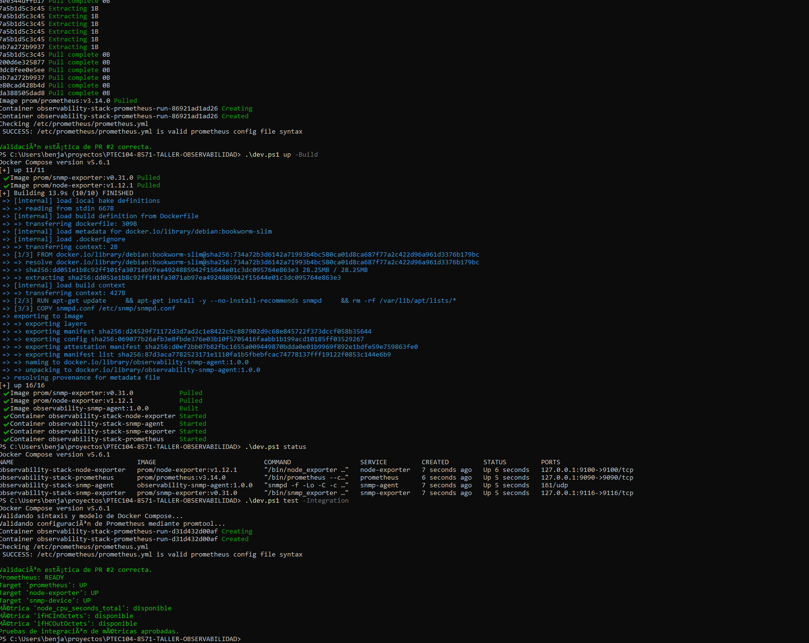
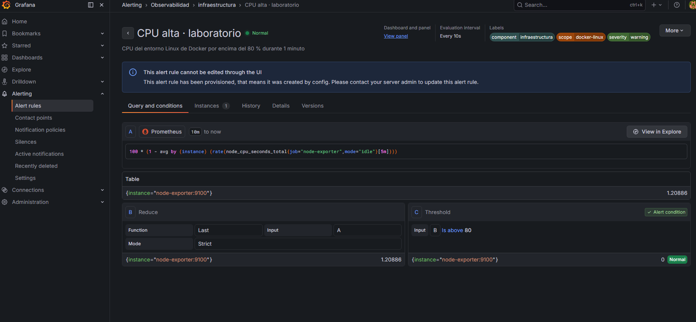
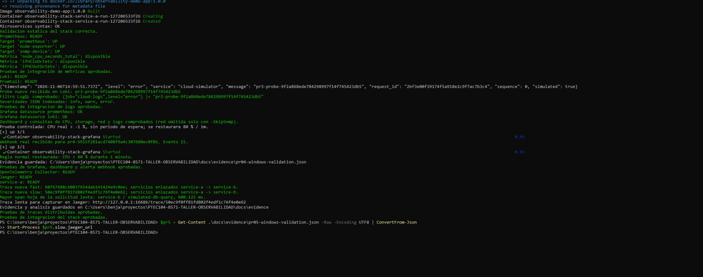
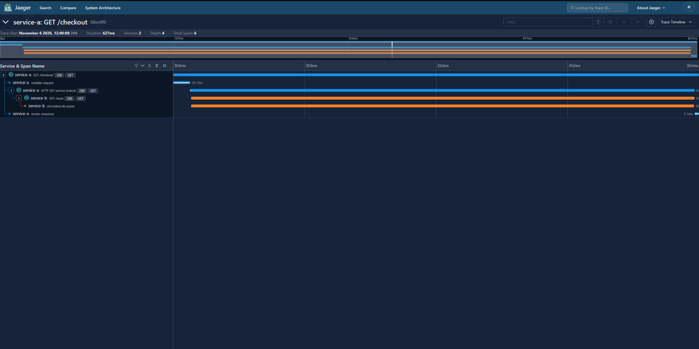

# Informe técnico — Stack de Observabilidad

Estado de esta versión: métricas, logs, Grafana/alertas y trazas distribuidas implementados y validados en Docker Desktop para Windows. La ejecución completa aprobó y Jaeger mostró la transacción entre dos servicios con seis spans. Este informe reúne el procedimiento, la justificación técnica, las capturas originales y las conclusiones del laboratorio.

## 1. Paso a paso documentado

### Preparación y ejecución

Benja utilizó Windows, Docker Desktop con contenedores Linux sobre WSL 2 y Git, clonó el repositorio y comprobó los comandos de Docker y Compose antes de aplicar los cambios por ramas.

Desde la raíz de **esta versión del proyecto**, ya sea el clon actualizado o la carpeta `proyecto/` del paquete:

```powershell
if (-not (Test-Path .env)) { Copy-Item .env.example .env }
.\dev.ps1 validate
.\dev.ps1 up -Build
.\dev.ps1 status
.\dev.ps1 test -Integration
```

Si Windows PowerShell bloquea scripts, `Set-ExecutionPolicy -Scope Process -ExecutionPolicy RemoteSigned` habilita el procedimiento solo para esa ventana. La guía detallada está en [PR04_GRAFANA.md](PR04.md#pr04_grafana).

La configuración completa define trece servicios. A los nueve de métricas, logs y Grafana/Webhook se suman Collector, Jaeger y los dos microservicios HTTP. Los datos de métricas, logs, posiciones y avisos utilizan volúmenes; `dev.ps1 down` detiene el entorno sin eliminarlos. Jaeger utiliza memoria y pierde las trazas activas al reiniciarse, por lo que se conservan sus JSON y capturas.

### Métricas y logs

Prometheus obtiene métricas de sí mismo, de Node Exporter y del agente de red mediante SNMP Exporter. La integración verificó los tres targets UP y la disponibilidad de node_cpu_seconds_total, ifHCInOctets e ifHCOutOctets.

El generador escribe JSON en un volumen compartido; Promtail extrae timestamp y level y envía las líneas a Loki. La integración crea un probe nuevo, lo encuentra mediante LogQL con level=error y verifica info, warn y error. No se acepta un log histórico cualquiera como prueba de ingesta actual. Guía: [PR03_LOGS.md](PR03.md#pr03_logs).

### Dashboard y alerta

Abrir <http://localhost:3000/d/operativo-observabilidad> con `admin` / `observability-lab` como credenciales iniciales de laboratorio. El provisioning crea automáticamente las fuentes Prometheus/Loki, el dashboard y las alertas. En storage se selecciona `/mnt/docker-desktop-disk`, identificado en las métricas reales del equipo.

El Dashboard Operativo reúne CPU, storage, tráfico SNMP y logs JSON con filtro de severidad y actualización de 5 segundos. Para streaming de logs se puede abrir Explore, elegir Loki y activar Live con `{job="cloud-logs"}`.

La regla normal evalúa CPU >80 % durante 1 minuto, cada 10 segundos. La prueba controlada mantiene la consulta real pero cambia temporalmente el umbral a -1 % y la espera a 0s, recibe un Webhook firing con UID y test_run únicos y restaura 80 % / 1 minuto. Esta prueba no demuestra una sobrecarga real por encima de 80 %.

### Validación realizada

La ejecución completa de Windows aprobó validación estática, métricas, logs y Grafana/Webhook. El terminal informó `Pruebas de integracion del stack aprobadas.` y verificó la restauración de la regla normal. Las capturas posteriores muestran el dashboard, la regla Normal y avisos firing/resolved para la misma prueba. El estado y los registros están en [PR04_VALIDACION.md](PR04.md#pr04_validacion).

El script escribió `docs/evidence/pr04-windows-validation.json` en el PC de Benja. Debe conservarse y añadirse al commit desde ese clon; no se inventa aquí su contenido. La preparación Linux tiene sus propios informes nativos y no se presenta como ejecución Docker de Windows.

### PR #5 — Trazas distribuidas

Se añaden Collector Contrib 0.164.0, Jaeger 2.23.0 y dos microservicios Python con OpenTelemetry 1.45.2. service-a recibe GET /checkout y llama a service-b con contexto W3C traceparent. Los dos SDK envían spans OTLP/HTTP al Collector; este los agrupa y exporta por OTLP/gRPC a Jaeger.

~~~powershell
.\dev.ps1 validate
.\dev.ps1 up -Build
.\dev.ps1 status
.\dev.ps1 test -Integration
~~~

La última fase de la integración crea dos solicitudes nuevas, consulta las trazas a Jaeger, comprueba relaciones padre-hijo y guarda pr05-windows-validation.json, los JSON de las trazas y pr05-windows-analysis.md. La URL de la transacción lenta queda impresa para abrirla en la UI. Guía reproducible: [PR05_TRAZAS.md](PR05.md#pr05_trazas).

La preparación aprobó validadores de configuración, sintaxis, nueve pruebas unitarias y la captura del OTLP real de dos procesos HTTP. El backend nativo no pudo arrancar en aquel ejecutor por visibilidad del PID. Posteriormente, Benja aprobó la recepción y consulta de Jaeger y la integración completa en Docker Desktop para Windows; las capturas originales se incluyen en la sección de evidencia.

## 2. Justificación técnica

### CPU

```promql
100 * (1 - avg by (instance) (rate(node_cpu_seconds_total{job="node-exporter",mode="idle"}[5m])))
```

El contador acumula segundos de CPU por modo. `rate()` estima la proporción de tiempo ocioso; restarla de uno y multiplicar por cien produce el porcentaje medio no ocioso. La ventana de 5 minutos suaviza variaciones. En la alerta, A obtiene el porcentaje, B reduce al último valor y C compara con 80. El período de permanencia de 1 minuto evita alertar por una sola evaluación; es distinto de la ventana de cálculo y de la evaluación cada 10 segundos.

`NoData` y `Error` se mantienen explícitos para distinguir una pérdida de telemetría de un estado sano. El test no acepta avisos DatasourceNoData o DatasourceError como prueba de una alerta real de CPU.

### Tráfico SNMP en Mbps

```promql
sum by (instance, ifName) (rate(ifHCInOctets{job="snmp-device",ifName!="lo"}[5m]) * 8 / 1000000)
sum by (instance, ifName) (rate(ifHCOutOctets{job="snmp-device",ifName!="lo"}[5m]) * 8 / 1000000)
```

IF-MIB proporciona contadores de octetos de 64 bits. `rate()` calcula octetos por segundo; multiplicar por ocho convierte a bits y dividir por un millón expresa Mbps decimales. ifName permite separar interfaces y se excluye loopback. La captura del laboratorio muestra tráfico pequeño y Grafana ajusta visualmente la escala a b/s; la consulta conserva la conversión a Mbps.

### Storage y alcance de las métricas

```promql
100 * (1 - node_filesystem_avail_bytes{job="node-exporter",mountpoint="/mnt/docker-desktop-disk"} / node_filesystem_size_bytes{job="node-exporter",mountpoint="/mnt/docker-desktop-disk"})
```

El panel calcula espacio no disponible para usuarios normales, incluidos bloques reservados. El montaje se elige con un selector; no se fija /dev/sdf porque el dispositivo puede cambiar al reiniciar. En la captura, el resultado fue 5,5 %.

Node Exporter observa el entorno Linux de Docker Desktop/WSL. CPU y storage no son telemetría nativa de Windows ni una medición del disco C:. Esta limitación forma parte de la interpretación del laboratorio.

### Logs y etiquetas

```logql
{job="cloud-logs",level="error"}
{job="cloud-logs",level="error"} |= "pr3-probe-"
```

level tiene pocos valores estables y permite filtrar severidad sin crear un stream por solicitud. request_id y el mensaje quedan en el cuerpo JSON para evitar alta cardinalidad. Promtail aplica el timestamp UTC del evento y conserva el registro para inspección.

El generador rota archivos a 5 MiB con tres respaldos. Loki usa almacenamiento persistente, WAL, índices TSDB y retención de siete días. Las posiciones de Promtail permiten continuar la lectura después de reiniciar; las pruebas nativas verificaron recuperación de registros y reanudación de ingesta.

### Provisioning, enrutamiento y prueba controlada

Los UID estables vinculan fuentes, dashboard y reglas sin repetir configuración manual. La política agrupa por carpeta, regla y ejecución de prueba y envía al contacto `webhook-laboratorio`, que llama al receptor por la red de Compose. SQLite conserva los avisos para revisión; la evaluación de Grafana y el HTTP son reales, aunque el destino representa una simulación local de notificaciones.

La prueba utiliza un test_run único y exige ruleUID=cpu-high, estado firing y un valor válido de CPU. La lectura UTF-8 explícita evita que Windows PowerShell altere el título al leer JSON sin BOM. El primer timeout motivó esa corrección y el reemplazo de la comparación por nombre por un UID estable; la repetición posterior de Windows pasó.

### Contexto, transporte y latencia del PR #5

service.name distingue service-a y service-b. El contexto W3C enlaza el span cliente HTTP con el span servidor remoto, de modo que se observa una transacción única, no dos trazas aisladas. El marcador test_run y el trace_id nuevo impiden aprobar con datos históricos.

La operación simulated-db-query espera 40 ms o 600 ms y etiqueta lab.simulated=true. Es una demora de código deliberada, no una base de datos real. La comparación permite localizar el tiempo de espera. El análisis utiliza la duración del span raíz y los spans hoja: los tiempos inclusivos de cliente, servidor e hijos no se suman como operaciones independientes.

Collector aplica memory_limiter y batch antes de exportar a Jaeger; los SDK conservan todas las solicitudes de demostración y agrupan sus envíos. Jaeger limita su almacenamiento de laboratorio a 5.000 trazas en memoria. Un reinicio lo vacía; los JSON de evidencia y las capturas se conservan en el clon. Estos valores son decisiones del laboratorio y no una prueba de capacidad de producción.

## 3. Evidencia de funcionamiento

### Métricas y logs anteriores





Registros: [logs en Windows](evidence/pr-03/README.md) e [integración nativa de logs](evidence/pr-03/results/pr03-native-validation.json).

### Integración completa hasta PR #4


El registro de esta captura está en [pr04-stack-windows-validation.md](evidence/pr-04/README.md). Confirma targets UP, métricas disponibles, un probe nuevo en Loki, fuentes Grafana OK, aviso Webhook recibido y regla normal restaurada.

### Dashboard Operativo


El montaje seleccionado es /mnt/docker-desktop-disk; se observan datos de CPU, 5,5 % de espacio no disponible, series de eth0 y eventos JSON. [Registro de observación](evidence/pr-04/README.md).

### Regla normal



La captura muestra CPU de aproximadamente 1,21 %, condición C `Is above 80`, estado Normal y evaluación cada 10 segundos. Su descripción menciona 1 minuto; el campo for=1m fue comprobado por la integración. [Registro de observación](evidence/pr-04/README.md).

### Webhook de activación y aviso posterior


Los eventos 9 y 10 comparten test_run `pr4-784177d6acb445e7ac34db2aae24f07a`. La CPU registrada ronda 1,6248 %, suficiente para el umbral temporal -1 %, no para presentar un incidente real >80 %. El aviso resolved incluye MissingSeries al retirarse la serie de prueba; la restauración de la regla se comprobó por separado. [Registro del receptor](evidence/pr-04/README.md).

### Alcance y archivos de evidencia

La integración real de Windows y las tres vistas requeridas por PR #4 están documentadas con capturas originales. [Resumen derivado de esas capturas](evidence/pr-04/results/pr04-windows-evidence-summary.json).

La preparación Linux consta en [pr04-native-validation.json](evidence/pr-04/results/pr04-native-validation.json): pipeline real, valor predeterminado ANSI emulado, Webhook, restauración y reinicio de Grafana. Omite SNMP y utiliza un filesystem Linux local; la ejecución de Windows cubrió las consultas SNMP y el montaje de Docker Desktop.

### Integración completa con trazas y observación en Jaeger

El [registro de SDK OTLP](evidence/pr-05/results/pr05-native-sdk-validation.json) contiene spans emitidos realmente por dos procesos HTTP. Se verificaron seis spans por solicitud, conservación del trace_id y relaciones padre-hijo entre servicios, además de errores HTTP 400/503/502. La petición fast midió 70,700 ms en su span raíz y 40,211 ms en la operación; slow midió 630,570 ms y 600,209 ms respectivamente. Estos valores proceden de la captura de protocolo de los SDK, no de una consulta a Jaeger.

Los [validadores y versiones](evidence/pr-05/results/pr05-preparation-checks.json) y el [límite de arranque del backend nativo](evidence/pr-05/results/pr05-native-backend-check.json) conservan el alcance histórico de la preparación. El resultado posterior de Windows procede del backend real.



La salida muestra Prometheus, Loki, Promtail, Collector y Jaeger READY, tres targets UP, el probe nuevo de logs y el Webhook controlado recibido como evento 15. Se restauró la regla de CPU >80 % / 1 minuto y aprobaron las pruebas de trazas y del stack completo. La [prueba independiente anterior](evidence/pr-05/screenshots/pr05-traces-windows.png) también muestra los trece contenedores Running.



La transacción `50ec9f0ff81fd802f4edf1c76f4e0e62` presenta dos servicios, seis spans y profundidad cuatro. La UI muestra una duración total redondeada de 627 ms. El árbol enlaza GET /checkout, el cliente HTTP de service-a, GET /work de service-b y simulated-db-query. La prueba midió 600.125 ms en esa operación hoja, aproximadamente el 96 % del total; el principal tiempo de espera de esta solicitud está en service-b. Los tiempos inclusivos de padres e hijos no se suman.

La demora es deliberada: el escenario slow espera 600 ms frente a 40 ms del escenario fast, sin una base de datos física. La llamada HTTP entre servicios, el contexto W3C y las trazas almacenadas/consultadas son reales. La [transcripción de las capturas](evidence/pr-05/README.md) distingue los valores observados, el redondeo de la UI y los JSON originales generados en el clon Windows.

## 4. Conclusiones y lecciones aprendidas

Prometheus permitió comprobar disponibilidad, CPU y red; Loki añadió registros filtrables por severidad y conservó el timestamp del evento. Grafana reunió estas señales en una vista operativa y la notificación Webhook demostró evaluación, enrutamiento, entrega e inspección de avisos.

Los identificadores únicos evitaron aceptar datos antiguos como prueba de funcionamiento actual. La persistencia de logs y avisos separa los datos del ciclo de vida de los contenedores. El incidente de codificación mostró la importancia de declarar UTF-8 y usar UID estables en validaciones entre plataformas.

La prueba de alertas evitó sobrecargar el equipo: cambió temporalmente una condición, registró el aviso y comprobó su restauración. Elegir el montaje a partir de las métricas observadas evitó atribuir el almacenamiento de Docker a Windows de forma incorrecta.

Las trazas completaron el tercer pilar: el contexto W3C conservó una sola transacción entre servicios y el árbol permitió localizar el tiempo de espera en service-b. Una operación hoja de unos 600 ms explica aproximadamente el 96 % de la transacción de 627 ms. Analizar solo los spans de cliente y servidor habría duplicado tiempos inclusivos y dificultado esa interpretación.

El HTTP 404 del chequeo de Jaeger mostró la necesidad de validar las rutas contra la versión fijada: se sustituyó /api/services por /api/v3/services y la repetición de Windows aprobó. La visibilidad limitada del PID en el ejecutor de preparación también mostró que una prueba de SDK y un validador de configuración no sustituyen un despliegue completo; este se comprobó posteriormente en Docker Desktop.

El laboratorio cumplió el despliegue e integración de métricas, logs, dashboard, alertas y trazas con evidencia real. Sus fuentes cloud y de red y las demoras de la aplicación son simulaciones explícitas; CPU y almacenamiento corresponden al entorno Linux de Docker. Jaeger conserva trazas en memoria, por lo que se exportan los resultados para evaluación. Promtail se mantiene por exigencia del enunciado pese a su fin de soporte; una evolución del proyecto deberá evaluar un agente mantenido como Alloy.

## Referencias

- Prometheus, funciones PromQL: <https://prometheus.io/docs/prometheus/latest/querying/functions/>.
- Node Exporter: <https://github.com/prometheus/node_exporter>.
- SNMP Exporter: <https://github.com/prometheus/snmp_exporter>.
- IF-MIB, RFC 2863: <https://www.rfc-editor.org/rfc/rfc2863>.
- Grafana, provisioning de alertas: <https://grafana.com/docs/grafana/latest/alerting/set-up/provision-alerting-resources/file-provisioning/>.
- Microsoft, codificación de Windows PowerShell: <https://learn.microsoft.com/en-us/powershell/module/microsoft.powershell.core/about/about_character_encoding?view=powershell-5.1>.

- OpenTelemetry, instrumentación Python: <https://opentelemetry.io/docs/languages/python/instrumentation/>.
- OpenTelemetry, configuración del Collector: <https://opentelemetry.io/docs/collector/configuration/>.
- Jaeger, despliegue v2: <https://www.jaegertracing.io/docs/2.23/deployment/>.

- Jaeger, migración de endpoints HTTP: <https://github.com/jaegertracing/jaeger/pull/9260>.
