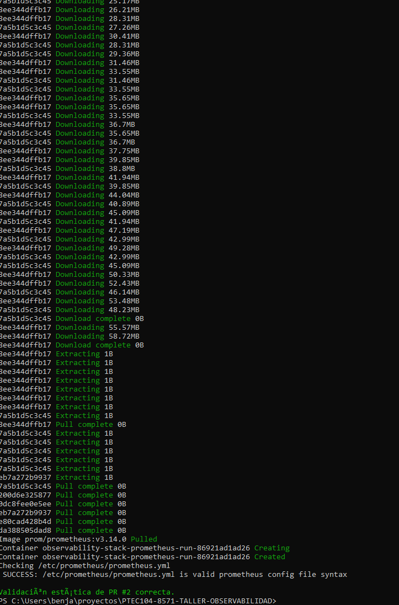
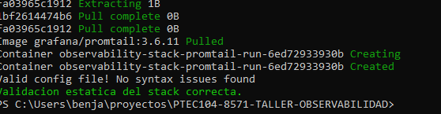
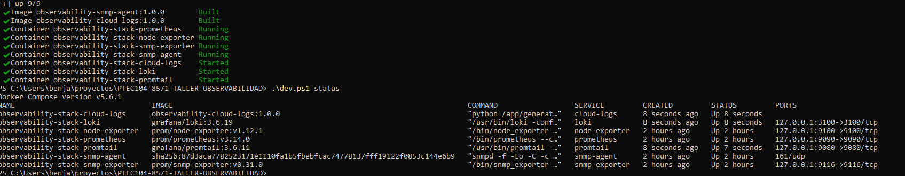
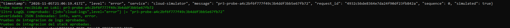

# Informe técnico — Stack de Observabilidad Completo

> Documento incremental. Registrar comandos y resultados reales del entorno de ejecución. No declarar pruebas aprobadas sin ejecutarlas.

## 1. Paso a paso documentado

### PR #1 — Repository Foundation

Registrar la preparación del repositorio, estructura y validaciones de Compose ejecutadas en el entorno de desarrollo.

### PR #2 — Infrastructure & Metrics

Procedimiento reproducible:

```powershell
Copy-Item .env.example .env
.\dev.ps1 validate
.\dev.ps1 up -Build
.\dev.ps1 status
.\dev.ps1 test -Integration
```

Servicios y endpoints locales:

- Prometheus: http://localhost:9090
- Node Exporter: http://localhost:9100/metrics
- SNMP Exporter: http://localhost:9116

Incorporar capturas reales de los targets `prometheus`, `node-exporter` y `snmp-device` en estado `UP`, además de las consultas PromQL ejecutadas.

La ejecución previa del estudiante en Windows confirmó los cuatro contenedores de métricas en estado Up y las pruebas de integración aprobadas. Se incluyen sus capturas originales en la sección de evidencias. Las capturas de las consultas PromQL siguen pendientes.

### PR #3 — Centralización de logs JSON

Se añade un generador sintético, Promtail y Loki. El generador escribe eventos JSON en un volumen Docker compartido; Promtail extrae timestamp y level, conserva el JSON como contenido y envía las líneas a Loki.

Procedimiento desde PowerShell, después de aplicar el PR:

~~~powershell
.\dev.ps1 validate
.\dev.ps1 up -Build
.\dev.ps1 status
.\dev.ps1 test -Integration
~~~

La validación comprueba Compose y las configuraciones de Prometheus, Loki y Promtail. La integración ejecuta primero métricas y después logs. Esta última crea un registro nuevo con identificador único, comprueba que llega a Loki con la etiqueta level=error y verifica info, warn y error.

En el entorno de preparación se ejecutó además el pipeline real con binarios Linux de Loki 3.6.19 y Promtail 3.6.11, junto al generador y PowerShell 7. Su resultado está en `evidence/pr03-native-validation.json`.

Después, Benja ejecutó estos comandos en Windows con Docker Desktop. La configuración fue validada, los siete contenedores quedaron Up y la integración recibió un probe nuevo en Loki con level=error. El resultado final fue `Pruebas de integracion del stack aprobadas.`. Las tres severidades fueron verificadas; las capturas y el registro están en la sección de evidencias.

La guía completa y los comandos de consulta están en [PR03_LOGS.md](PR03_LOGS.md).

## 2. Justificación técnica

Prometheus utiliza un modelo de scraping periódico y almacena las series temporales en su TSDB. Node Exporter publica métricas del entorno Linux observado. SNMP Exporter consulta el agente SNMP y transforma los objetos IF-MIB en métricas compatibles con Prometheus.

### CPU

```promql
100 * (1 - avg by (instance) (rate(node_cpu_seconds_total{mode="idle"}[5m])))
```

La métrica `node_cpu_seconds_total` es un contador acumulativo de segundos de CPU por modo. `rate()` estima la tasa por segundo; al restar el modo `idle` de uno y multiplicar por cien se obtiene el porcentaje medio no ocioso.

### Tráfico de red entrante y saliente

```promql
sum by (instance, ifName) (rate(ifHCInOctets{ifName!="lo"}[5m]) * 8 / 1000000)
sum by (instance, ifName) (rate(ifHCOutOctets{ifName!="lo"}[5m]) * 8 / 1000000)
```

Los objetos `ifHCInOctets` e `ifHCOutOctets` representan contadores de octetos de 64 bits de IF-MIB. `rate()` permite derivar la tasa de crecimiento del contador; el factor ocho convierte octetos a bits y el divisor 1.000.000 expresa el resultado en Mbps decimales.

**Limitación del entorno Windows:** Node Exporter se ejecuta como contenedor Linux y observa el entorno Linux/VM de Docker Desktop, no las métricas nativas del kernel Windows. Esta distinción debe explicitarse en la interpretación de resultados.

### Logs y selección de etiquetas

La severidad tiene pocos valores estables (info, warn y error), por lo que level permite filtrar sin multiplicar los streams por cada solicitud. request_id queda en el cuerpo JSON. El pipeline usa el timestamp UTC del evento y conserva el resto del registro para inspeccionarlo posteriormente.

El generador rota archivos a 5 MiB con tres respaldos; Loki conserva datos durante siete días y usa WAL e índices persistentes. Los volúmenes separan los datos del ciclo de vida del contenedor. La prueba busca un identificador nuevo, en vez de aceptar cualquier log histórico como evidencia de funcionamiento.

## 3. Evidencia de funcionamiento

### Evidencias disponibles

Capturas reales proporcionadas por el estudiante durante la preparación:




Prueba ejecutada en el entorno de preparación:

- [Registro de integración nativa de logs](evidence/pr03-native-validation.json): ingesta de un log nuevo, filtro por severidad, timestamps JSON, prueba PowerShell, rechazo de un probe inexistente y recuperación tras reinicios.

### PR #3 validado en Windows







Registro de esta ejecución: [pr03-windows-validation.md](evidence/pr03-windows-validation.md).

### Evidencias pendientes para la entrega completa

Pendiente de incorporar evidencias reales del entorno:

- Salida de `docker compose ps`.
- Prometheus: página Status / Targets con los tres jobs en `UP`.
- Prometheus: ejecución de la consulta de CPU.
- Prometheus: ejecución de las consultas de tráfico entrante y saliente.
- SNMP Exporter: respuesta del endpoint `/snmp` con las métricas IF-MIB.
- Resultado de ` .\dev.ps1 test -Integration`.
- Dashboard y alerta Webhook de Grafana (PR #4).
- Transacción distribuida y análisis de latencia en Jaeger (PR #5).

No incluir capturas simuladas ni resultados no ejecutados.

## 4. Conclusiones y lecciones aprendidas

Conclusiones parciales: el bloque de métricas permitió comprobar la disponibilidad de los exporters y el scraping desde Windows con Docker Desktop. El bloque de logs añadió severidad consultable y conservación del timestamp del evento. La prueba con un identificador nuevo evita confundir datos históricos con una ingesta actual.

Las posiciones de Promtail y el almacenamiento de Loki permitieron continuar recolectando y recuperar registros después de reiniciar procesos en la prueba nativa. La ejecución posterior en Windows confirmó el arranque Docker y el recorrido real del probe hasta Loki. Quedan pendientes las visualizaciones y alertas del PR #4 y las trazas del PR #5.

Promtail se utiliza por exigencia del enunciado, aunque Grafana lo declara fuera de soporte. Una evolución del sistema deberá evaluar un agente mantenido como Alloy. No se concluye que el stack completo esté finalizado mientras falten esas validaciones y evidencias.

## Referencias

- Prometheus Authors. (s. f.). *Query functions*. https://prometheus.io/docs/prometheus/latest/querying/functions/
- Prometheus Authors. (s. f.). *Node Exporter*. https://github.com/prometheus/node_exporter
- Prometheus Authors. (s. f.). *SNMP Exporter*. https://github.com/prometheus/snmp_exporter
- McCloghrie, K., & Kastenholz, F. (2000). *The interfaces group MIB (RFC 2863)*. Internet Engineering Task Force. https://www.rfc-editor.org/rfc/rfc2863
