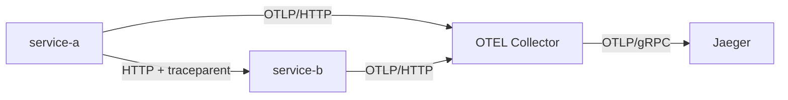

# PR05 - Documentacion consolidada

Este documento conserva las secciones historicas del PR, sin presentar pruebas nuevas. Cada apartado indica el archivo de procedencia.

## PR05_DESCRIPCION

*Fuente: `docs/PR05_DESCRIPCION.md`.*

Incorpora trazas distribuidas a la aplicación: service-a llama a service-b con contexto W3C y ambos envían spans por OTLP/HTTP al Collector, que los exporta por OTLP/gRPC a Jaeger.

Añade Collector, Jaeger y los dos microservicios a Docker Compose, con versiones fijadas. Incluye escenarios fast/slow de 40/600 ms, prueba de trazas nuevas con relaciones padre-hijo, exportación de la evidencia y análisis del span hoja de mayor duración. Corrige el chequeo de disponibilidad para la API v3 de Jaeger.

Validado en Windows con Docker Desktop: trece contenedores Running e integración completa de métricas, logs, Grafana/Webhook y trazas aprobada. La captura de Jaeger muestra dos servicios, seis spans y una transacción de unos 627 ms; simulated-db-query, en service-b, concentra 600.125 ms, aproximadamente el 96 % del total.

La demora es simulada deliberadamente; HTTP, contexto W3C, SDK, Collector y Jaeger funcionan realmente. Jaeger usa memoria en este laboratorio. Se incluyen capturas originales y el informe técnico actualizado; los JSON generados en Windows se conservan en docs/evidence/.

---

## PR05_TRAZAS

*Fuente: `docs/PR05_TRAZAS.md`.*

# PR #5 — OpenTelemetry, Jaeger y microservicios

Este cambio añade cuatro servicios al stack validado del PR #4: Jaeger 2.23.0, OpenTelemetry Collector Contrib 0.164.0, service-a y service-b. El total configurado pasa de nueve a **trece servicios**. Los componentes anteriores se conservan.

**Validación realizada en Windows:** integración completa aprobada y traza abierta en Jaeger con dos servicios y seis spans. El resultado y las capturas originales están en [PR05_VALIDACION.md](PR05.md#pr05_validacion).

## 1. Desplegar y validar en Windows

Docker Desktop debe estar abierto con contenedores Linux. Ejecutar desde la raíz de esta versión del proyecto:

```powershell
.\dev.ps1 validate
.\dev.ps1 up -Build
.\dev.ps1 status
.\dev.ps1 test -Integration
```

No se necesita Python instalado en Windows: las dependencias de los microservicios se instalan dentro de la imagen Docker, con versiones fijadas en `app/requirements.txt`. Se mantiene Python 3.12.12 como base de contenedor.

La validación estática comprueba Compose, Prometheus, Loki, Promtail, Grafana, Jaeger, Collector y sintaxis Python. La integración ejecuta métricas, logs, Grafana/Webhook y finalmente trazas. Deben aparecer `Pruebas de trazas distribuidas aprobadas.` y `Pruebas de integracion del stack aprobadas.` para considerar aprobada esta ejecución.

Para repetir solo trazas una vez iniciado el entorno:

```powershell
.\tests\validation\test-traces.ps1
```

| Interfaz | URL local |
|---|---|
| Aplicación service-a | <http://localhost:8082> |
| Petición rápida | <http://localhost:8082/checkout?scenario=fast> |
| Petición lenta | <http://localhost:8082/checkout?scenario=slow> |
| Jaeger UI | <http://localhost:16686> |
| Salud del Collector | <http://localhost:13133> |
| Dashboard existente | <http://localhost:3000/d/operativo-observabilidad> |

service-b no publica un puerto en Windows. service-a lo llama por la red de Compose. El endpoint /health de service-a también comprueba que el worker responde.

## 2. Recorrido de la transacción



service-a recibe GET /checkout, ejecuta validate-request y llama a service-b. La llamada HTTP lleva el contexto W3C traceparent. service-b crea su span servidor bajo el span cliente de service-a y ejecuta simulated-db-query. Cada proceso exporta sus spans mediante el SDK OpenTelemetry a Collector; este aplica límite de memoria y batching y los entrega a Jaeger por OTLP/gRPC.

La transacción normal tiene seis spans:

1. service-a: GET /checkout, servidor raíz.
2. service-a: validate-request, unos 20 ms de trabajo simulado.
3. service-a: HTTP GET service-b/work, span cliente.
4. service-b: GET /work, span servidor hijo del cliente remoto.
5. service-b: simulated-db-query, demora deliberada de 40 ms o 600 ms.
6. service-a: render-response, unos 5 ms de trabajo simulado.

La demora está etiquetada lab.simulated=true y lab.delay_ms. No existe una base de datos real en esta aplicación. Las peticiones HTTP, el contexto distribuido, los spans y la exportación son reales.

## 3. Qué comprueba la integración

El script genera dos solicitudes nuevas, fast y slow, cada una con test_run único. Exige:

- El mismo trace_id válido en las respuestas de ambos servicios.
- Una traza recuperada realmente desde la API de Jaeger, no solo un ID impreso por la aplicación.
- Spans de service-a y service-b, con el marcador de esa solicitud.
- Referencias CHILD_OF correctas entre raíz, cliente HTTP, servidor remoto y operación interna.
- La demora configurada en las etiquetas y una duración medida coherente.
- Un span hoja de mayor duración identificado para analizar el cuello de botella.

Los spans padre incluyen el tiempo de sus hijos. No se suman todas las duraciones para calcular el tiempo total: se utiliza la duración del span raíz y se compara con los spans hoja.

La integración guarda automáticamente en docs/evidence/:

- pr05-windows-validation.json: estado, IDs, duraciones, referencias y enlaces.
- pr05-windows-fast-trace.json y pr05-windows-slow-trace.json: respuestas reales de Jaeger.
- pr05-windows-analysis.md: comparación de tiempos y operación hoja más lenta.

Un fallo se registra como failed; una traza antigua de otra solicitud no sirve para aprobar.

## 4. Abrir y analizar en Jaeger

Después de aprobar la integración:

```powershell
$pr5 = Get-Content .\docs\evidence\pr05-windows-validation.json -Raw -Encoding UTF8 | ConvertFrom-Json
Start-Process $pr5.slow.jaeger_url
```

También se puede abrir Jaeger, seleccionar service-a, buscar GET /checkout y elegir una solicitud reciente. El enlace impreso por la integración evita confundir trazas de ejecuciones distintas.

En la vista de la traza:

1. Confirmar que aparecen service-a y service-b en la misma transacción.
2. Expandir la llamada HTTP y el servidor remoto.
3. Seleccionar simulated-db-query y observar duración y etiquetas.
4. Comparar con el escenario fast usando los enlaces del informe JSON.

El escenario slow busca hacer visible el tiempo de espera de la operación simulada de service-b. El análisis generado registra los tiempos efectivamente observados; no supone que los valores nominales sean exactamente las duraciones medidas.

## 5. Evidencia y análisis observado

- [Integración completa aprobada](evidence/pr-05/screenshots/pr05-integration-windows.png).
- [Traza lenta abierta en Jaeger](evidence/pr-05/screenshots/pr05-jaeger-trace-windows.png).
- [Prueba independiente y trece contenedores Running](evidence/pr-05/screenshots/pr05-traces-windows.png).
- [Registro de observación y análisis de latencia](evidence/pr-05/README.md#registro-pr05-windows-validation-md).

La traza lenta de la ejecución completa tiene ID 50ec9f0ff81fd802f4edf1c76f4e0e62. Jaeger muestra dos servicios, seis spans y una duración total redondeada de 627 ms. La prueba midió 600.125 ms en simulated-db-query de service-b, aproximadamente el 96 % de ese total. El árbol hace visible la espera dentro de la llamada HTTP; los tiempos inclusivos de padres e hijos no se suman.

Los JSON y el análisis detallado se generan en el clon Windows. Deben conservarse y versionarse con las capturas. La imagen recibida muestra el árbol de spans; para inspeccionar los atributos en una demostración, seleccionar simulated-db-query y desplegar sus etiquetas.

## 6. Persistencia y límites del laboratorio

Jaeger utiliza un almacén en memoria de hasta 5.000 trazas. Reiniciarlo elimina su contenido; volver a generar peticiones lo repuebla. Los JSON guardados en el clon y las capturas conservan la evidencia para evaluar sin un entorno activo. El volumen jaeger-data reservado en etapas anteriores no se utiliza como almacenamiento persistente en esta modalidad.

El muestreo conserva todas las solicitudes de demostración y respeta el contexto padre. El Collector limita su memoria y agrupa envíos con timeout de 1 segundo. Estos valores sirven al volumen bajo del taller; no son una estimación de capacidad de producción.

La recepción en Collector/Jaeger y la integración del stack completo se validaron después en Docker Desktop para Windows. En preparación se habían aprobado validadores de configuración y las pruebas de los dos procesos HTTP y sus spans SDK OTLP reales, pero aquel ejecutor no exponía los PID numéricos necesarios para arrancar Jaeger. Ese límite histórico no se oculta ni se confunde con el resultado posterior de Windows.

## 7. Diagnóstico

```powershell
.\dev.ps1 logs -Service jaeger
.\dev.ps1 logs -Service otel-collector
.\dev.ps1 logs -Service service-a
.\dev.ps1 logs -Service service-b
```

Si Jaeger está vacío, generar una petición nueva y esperar el batching. Comprobar que Collector responde y que sus logs no muestran errores al exportar. La aplicación usa http://otel-collector:4318/v1/traces y Collector usa jaeger:4317 dentro de Compose; localhost desde un contenedor no identifica otro servicio.

El chequeo de Jaeger usa /api/v3/services: /api/services devuelve 404 en la versión fijada. Si aparece el error de conexión npipe dockerDesktopLinuxEngine, iniciar Docker Desktop y esperar a que el motor esté disponible antes de repetir el arranque.

Si una prueba falla, conservar su salida y el JSON de estado. No se corrige borrando volúmenes del stack ya validado.

## Referencias

- Instrumentación Python: <https://opentelemetry.io/docs/languages/python/instrumentation/>.
- Contexto W3C: <https://opentelemetry.io/docs/concepts/context-propagation/>.
- Configuración del Collector: <https://opentelemetry.io/docs/collector/configuration/>.
- Jaeger v2: <https://www.jaegertracing.io/docs/2.23/deployment/>.
- Configuración de referencia de Jaeger: <https://github.com/jaegertracing/jaeger/blob/v2.23.0/cmd/jaeger/internal/all-in-one.yaml>.

---

## PR05_VALIDACION

*Fuente: `docs/PR05_VALIDACION.md`.*

# Validación — PR #5

**Estado: integración completa aprobada en Docker Desktop para Windows y traza observada en Jaeger.** Las capturas originales y su transcripción están en [evidence/pr-05/README.md#registro-pr05-windows-validation-md](evidence/pr-05/README.md#registro-pr05-windows-validation-md).

| Comprobación | Resultado | Evidencia o alcance |
|---|---|---|
| Modelo Compose y configuraciones | Aprobados | Preparación y validación estática de Windows |
| Pruebas unitarias de preparación | Nueve aprobadas | Tres de parámetros de app y seis existentes de generador/receptor |
| Dos procesos HTTP, contexto W3C y SDK OTLP | Aprobados en preparación | Captura protobuf real; seis spans por solicitud; errores 400/503/502 comprobados |
| Backend nativo en el ejecutor de preparación | No pudo arrancar | Limitación histórica de visibilidad del PID en /proc; no se presenta como aprobado |
| Trece contenedores Docker | Running | [Prueba independiente de Windows](evidence/pr-05/screenshots/pr05-traces-windows.png) |
| Métricas y logs | Aprobados en Windows | Targets UP, contadores disponibles y probe nuevo en Loki |
| Grafana y Webhook | Aprobados en Windows | Fuentes y consultas correctas, evento 15 y regla normal restaurada |
| Collector y Jaeger | READY en Windows | [Integración completa](evidence/pr-05/screenshots/pr05-integration-windows.png) |
| Ingesta y consulta de trazas nuevas | Aprobadas en Windows | Solicitudes fast/slow con ambos servicios y verificación de referencias padre-hijo |
| Integración de todo el stack | Aprobada en Windows | Mensaje final de aprobación después de métricas, logs, Grafana y trazas |
| Evidencia visual de Jaeger | Recibida | [Transacción lenta](evidence/pr-05/screenshots/pr05-jaeger-trace-windows.png): dos servicios y seis spans |
| Análisis de latencia | Documentado | Transacción de unos 627 ms; mayor span hoja de 600.125 ms, aproximadamente 96 % del total |

## Corrección de compatibilidad

La primera prueba de disponibilidad consultaba /api/services y recibió HTTP 404. Se corrigieron el script Windows y el runner nativo para usar /api/v3/services, conforme a la [migración oficial de Jaeger](https://github.com/jaegertracing/jaeger/pull/9260). La consulta individual de /api/traces/{traceID} conservada en esta versión sigue validando el contenido real de las trazas. Después de la corrección aprobaron tanto la prueba independiente como la integración completa de Windows.

## Evidencia y trazabilidad

- [Prueba independiente y trece contenedores Running](evidence/pr-05/README.md#registro-pr05-traces-windows-md).
- [Integración completa y análisis de la captura de Jaeger](evidence/pr-05/README.md#registro-pr05-windows-validation-md).
- [Resultados históricos de SDK y protocolo OTLP](evidence/pr-05/results/pr05-native-sdk-validation.json).
- [Límite del backend nativo en preparación](evidence/pr-05/results/pr05-native-backend-check.json).
- [Versiones, assets y verificaciones de preparación](evidence/pr-05/results/pr05-preparation-checks.json).

Los campos Windows pendiente de los informes de preparación describen el estado histórico de esa ejecución. El resultado posterior de Docker Desktop se documenta por separado con las capturas originales.

Los JSON de Windows y el análisis detallado se generan en el clon mediante el script y se versionan desde ese equipo. No se han reconstruido a partir de las imágenes. El retardo de la operación es una simulación explícita; la instrumentación, la exportación y el almacenamiento/consulta en Jaeger son reales.

---

## PR05_CIERRE

*Fuente: `docs/PR05_CIERRE.md`.*

# Cierre documental — PR #5

## Resultado verificado

La integración completa en Docker Desktop para Windows aprobó métricas, logs, Grafana/Webhook y trazas. Jaeger muestra dos servicios y seis spans; la transacción lenta dura unos 627 ms y simulated-db-query de service-b concentra 600.125 ms. Las capturas originales y el análisis están incorporados a INFORME.md.

El parche de cierre solo modifica documentación y añade capturas originales. No modifica configuraciones de ejecución ni sobrescribe los JSON de validación generados en Windows.

## Aplicar el cierre

Para una instalación que ya tiene PR5 y la corrección /api/v3/services, aplicar únicamente PR5_CIERRE.patch desde la raíz del clon. No reaplicar PR5.patch.

En PowerShell, ejecutar uno por uno:

```powershell
Set-Location "C:\Users\benja\proyectos\PTEC104-8571-TALLER-OBSERVABILIDAD"
git apply --ignore-space-change --check "C:\Users\benja\Desktop\PR5_Trazas_Benja\PR5_CIERRE.patch"
git apply --ignore-space-change "C:\Users\benja\Desktop\PR5_Trazas_Benja\PR5_CIERRE.patch"
git branch --show-current
git status --short
git diff --check
```

La rama prevista es feature/pr-05-trazas. Si git apply vuelve al prompt sin mensajes, terminó correctamente. Si aparece un error, conservarlo y detener los pasos siguientes.

## Conservar el resultado del equipo Windows

La prueba genera en docs/evidence/ pr05-windows-validation.json, pr05-windows-fast-trace.json, pr05-windows-slow-trace.json y pr05-windows-analysis.md. Deben permanecer en el clon y añadirse al commit junto a las capturas. El parche no genera ni reconstruye esos archivos.

Revisar el informe y las capturas antes del commit. Desde la rama prevista:

```powershell
git add README.md app configs dev.ps1 docker-compose.yml tests docs
git diff --cached --stat
git commit -m "feat(tracing): add OpenTelemetry collector Jaeger and traced microservices"
git push -u origin feature/pr-05-trazas
```

Abrir el Pull Request con base main y comparación feature/pr-05-trazas. El título puede ser el mismo del commit; el texto de docs/PR05_DESCRIPCION.md está actualizado para copiar en su descripción. El número asignado por GitHub puede diferir del nombre de esta etapa.

Las pruebas de runtime ya aprobaron antes de este cierre, que solo añade documentación y capturas. La aprobación técnica no significa que el commit, el push o la fusión del Pull Request ya se hayan realizado.

---
