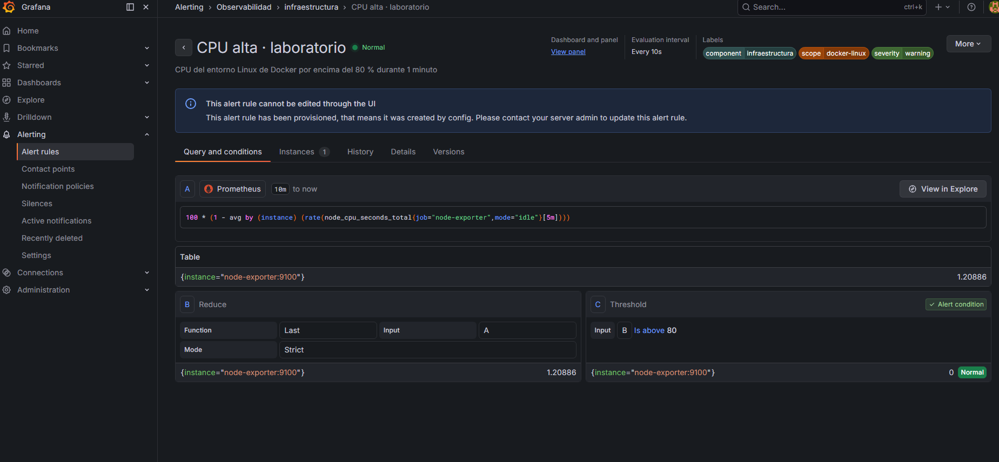
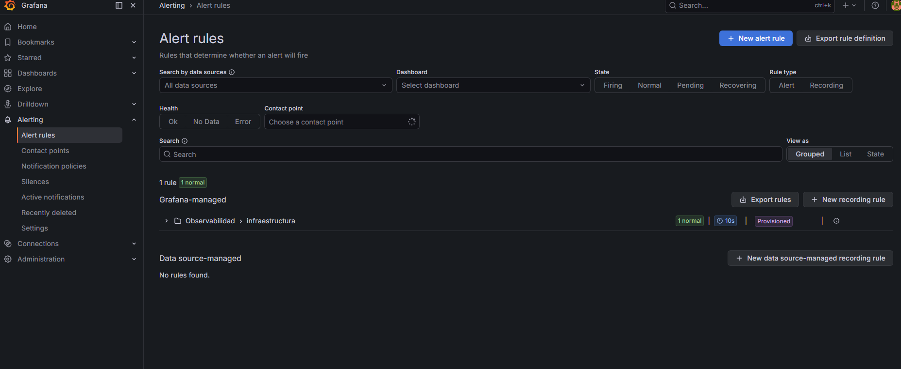
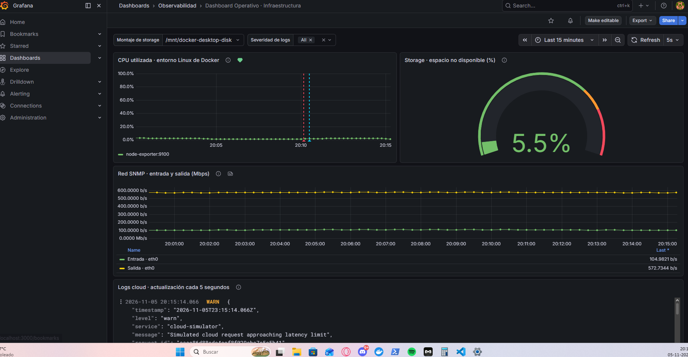
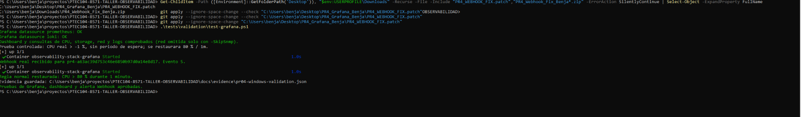
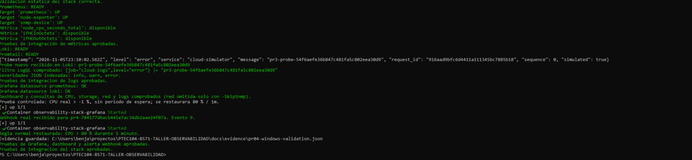
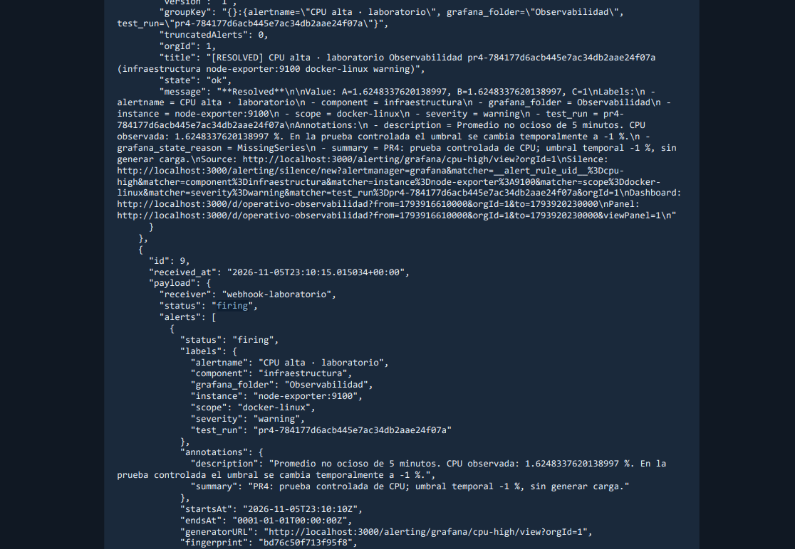
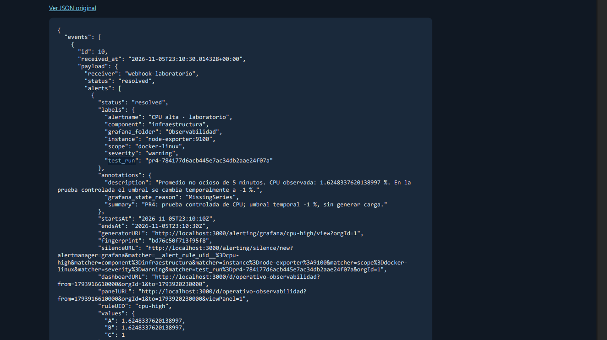

# Evidencias PR #4

Registro organizado del bloque pr-04. Las capturas y los resultados mantienen sus nombres originales.

> Las secciones documentales siguientes reproducen las notas anteriores e indican su archivo de origen; no representan nuevas ejecuciones de pruebas.

## Archivos de evidencia

| Archivo | Tipo |
|---|---|
| [pr04-alert-list-windows.png](screenshots/pr04-alert-list-windows.png) | screenshots |
| [pr04-alert-rule-windows.png](screenshots/pr04-alert-rule-windows.png) | screenshots |
| [pr04-dashboard-windows.png](screenshots/pr04-dashboard-windows.png) | screenshots |
| [pr04-grafana-webhook-windows.png](screenshots/pr04-grafana-webhook-windows.png) | screenshots |
| [pr04-native-validation.json](results/pr04-native-validation.json) | results |
| [pr04-preparation-checks.json](results/pr04-preparation-checks.json) | results |
| [pr04-stack-integration-windows.png](screenshots/pr04-stack-integration-windows.png) | screenshots |
| [pr04-storage-mount-windows.png](screenshots/pr04-storage-mount-windows.png) | screenshots |
| [pr04-webhook-resolved-windows.png](screenshots/pr04-webhook-resolved-windows.png) | screenshots |
| [pr04-webhook-timeout-windows.png](screenshots/pr04-webhook-timeout-windows.png) | screenshots |
| [pr04-webhook-windows.png](screenshots/pr04-webhook-windows.png) | screenshots |
| [pr04-windows-evidence-summary.json](results/pr04-windows-evidence-summary.json) | results |
| [pr04-windows-validation.json](results/pr04-windows-validation.json) | results |

## Registro: pr04-alert-rule-windows.md

*Fuente histórica: `docs/evidence/pr04-alert-rule-windows.md`.*

# Regla normal de CPU observada en Grafana — Windows

Capturas originales aportadas por Benja el 5 de noviembre de 2026, después de aprobar la integración completa.

La página de la regla muestra:

- Nombre `CPU alta · laboratorio`, estado Normal y evaluación cada 10 segundos.
- Consulta A: porcentaje medio no ocioso de CPU de Node Exporter sobre una ventana de 5 minutos.
- Valor de CPU mostrado: 1,20886 %.
- Reducción B: último valor de A; la interfaz muestra su modo predeterminado Strict.
- Condición C: `Is above 80`, evaluada como falsa (0) y en estado Normal.
- Etiquetas component=infraestructura, scope=docker-linux y severity=warning.
- Mensaje de provisioning: la regla procede de los archivos del proyecto.

La descripción visible menciona el minuto de permanencia. El campo de configuración `for` no aparece desplegado en esta captura; la integración de PowerShell sí verificó su restauración a 1 minuto, junto al umbral 80, antes de aprobar. Se distinguen la evaluación cada 10 segundos, la ventana de cálculo de 5 minutos y el minuto durante el que debe mantenerse la condición.



La vista general también muestra una regla Normal, un grupo provisionado y frecuencia de evaluación de 10 segundos:



La captura del receptor Webhook también se incorporó: pr04-webhook-windows.png y pr04-webhook-resolved-windows.png.

---

## Registro: pr04-dashboard-windows.md

*Fuente histórica: `docs/evidence/pr04-dashboard-windows.md`.*

# Dashboard Operativo observado en Windows

Captura original aportada por Benja el 5 de noviembre de 2026, después de aprobar la integración completa del stack.

La imagen muestra el Dashboard Operativo de Infraestructura con:

- Montaje de storage seleccionado: `/mnt/docker-desktop-disk`.
- Panel de CPU con datos de `node-exporter:9100` y anotaciones de alerta.
- Gauge de storage: 5,5 % de espacio no disponible, según la fórmula del panel. No se atribuye al disco C: de Windows.
- Series SNMP de entrada y salida para eth0, con muestras continuas.
- Panel Loki con eventos JSON del servicio cloud-simulator y severidad WARN visible.
- Actualización automática del dashboard cada 5 segundos.

La consulta de red convierte los contadores a Mbps; la captura presenta una escala automática de bits por segundo para este tráfico pequeño. No se interpreta como una medición de gran capacidad de red.



Esta captura valida la presentación conjunta de las cuatro señales del dashboard. Las capturas de la regla normal y del receptor Webhook también se incorporaron; ver PR04_VALIDACION.md en el directorio superior.

---

## Registro: pr04-grafana-windows-validation.md

*Fuente histórica: `docs/evidence/pr04-grafana-windows-validation.md`.*

# Validación real de Grafana y Webhook en Windows

Fecha de observación: 5 de noviembre de 2026. Evidencia aportada por Benja tras aplicar `PR4_WEBHOOK_FIX.patch`.

Comando mostrado en la captura:

```powershell
.\tests\validation\test-grafana.ps1
```

Resultados visibles:

- Fuentes Prometheus y Loki: OK.
- Dashboard y consultas de CPU, storage, red y logs: comprobados.
- La prueba controlada utilizó CPU real con umbral temporal -1 %.
- El receptor recibió un Webhook real para el identificador de esta ejecución (evento 5).
- La regla normal fue restaurada: CPU > 80 % durante 1 minuto.
- El script informó `Pruebas de Grafana, dashboard y alerta Webhook aprobadas.`.
- El script guardó `docs/evidence/pr-04/results/pr04-windows-validation.json` en el equipo del estudiante. Sus bytes todavía no se han proporcionado aquí; este registro no los sustituye.



Alcance: se valida la ejecución independiente de test-grafana.ps1 después de la corrección. La integración completa con dev.ps1 y las capturas del dashboard, la regla y el receptor se incorporaron posteriormente. Este registro conserva el alcance de la prueba independiente.

---

## Registro: pr04-stack-windows-validation.md

*Fuente histórica: `docs/evidence/pr04-stack-windows-validation.md`.*

# Integración completa del PR #4 en Windows

Fecha de observación: 5 de noviembre de 2026. Captura real aportada por Benja después de corregir la lectura UTF-8 y el reconocimiento del Webhook por UID.

Procedimiento solicitado y resultado presentado:

```powershell
.\dev.ps1 test -Integration
```

Resultados visibles en la captura:

- Validación estática del stack correcta.
- Prometheus READY y targets prometheus, node-exporter y snmp-device UP.
- Métricas node_cpu_seconds_total, ifHCInOctets e ifHCOutOctets disponibles; integración de métricas aprobada.
- Loki y Promtail READY; un probe nuevo del generador llegó a Loki con level=error y fue localizado por LogQL.
- Severidades JSON info, warn y error indexadas; integración de logs aprobada.
- Fuentes Prometheus y Loki de Grafana OK; dashboard y consultas de CPU, storage, red y logs comprobados.
- Grafana envió un Webhook real para la ejecución controlada, recibido como evento 9.
- La regla normal fue restaurada: CPU > 80 % durante 1 minuto.
- Resultado final: `Pruebas de integracion del stack aprobadas.`.



El script guardó `docs/evidence/pr-04/results/pr04-windows-validation.json` en el PC de Benja. El archivo no se ha adjuntado aquí; este registro documenta lo visible en la captura y no inventa sus valores internos.

La evidencia demuestra la integración funcional del alcance hasta PR #4. Las capturas posteriores del Dashboard Operativo, la regla normal y el receptor ya completan la documentación visual del PR #4. Las trazas de Jaeger y OpenTelemetry corresponden al PR #5.

---

## Registro: pr04-webhook-windows.md

*Fuente histórica: `docs/evidence/pr04-webhook-windows.md`.*

# Avisos Webhook observados en Windows

Capturas originales aportadas por Benja el 5 de noviembre de 2026, después de aprobar la integración completa del stack.

| Dato visible | Aviso de activación | Aviso posterior |
|---|---|---|
| Evento del receptor | 9 | 10 |
| Estado | firing | resolved |
| Recepción (UTC) | 2026-11-05T23:10:15.015034+00:00 | 2026-11-05T23:10:30.014328+00:00 |
| Identificador de prueba | pr4-784177d6acb445e7ac34db2aae24f07a | El mismo identificador |
| Regla | CPU alta · laboratorio | CPU alta · laboratorio; ruleUID cpu-high visible |
| CPU registrada | Aproximadamente 1,6248 % | El mismo valor conservado en el aviso |

La anotación de ambos avisos identifica una **prueba controlada con umbral temporal -1 %**, sin generar carga adicional. No es evidencia de que la CPU superase 80 % durante un minuto.

El aviso resolved contiene `grafana_state_reason: MissingSeries`. Al finalizar la prueba, el script retira la etiqueta temporal y restaura la regla normal. El motivo observado es compatible con retirar esa serie de prueba; no se interpreta como una medición de descenso de CPU. La restauración a 80 % / 1 minuto fue comprobada por separado por el script y la regla aparece Normal en Grafana.





Las capturas confirman activación y aviso posterior para la misma ejecución. El receptor y sus registros son reales; el destino es una simulación local de un sistema de notificaciones externo.

---

