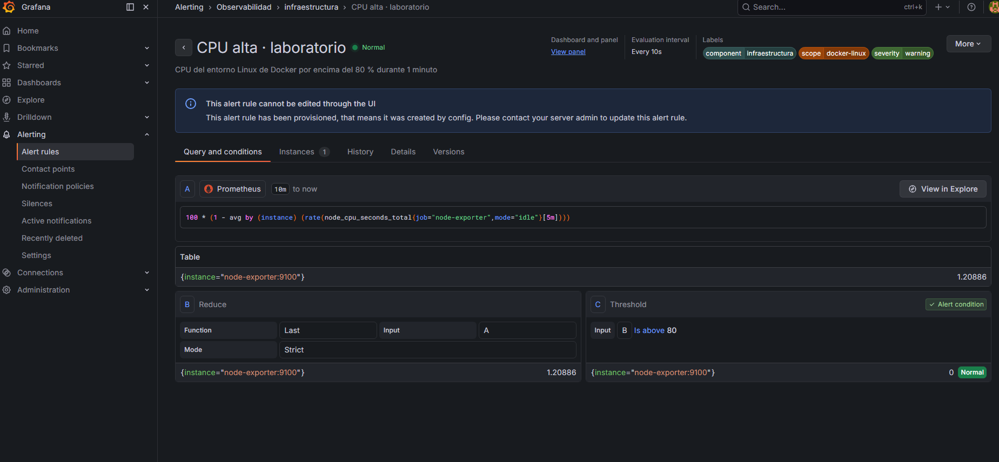
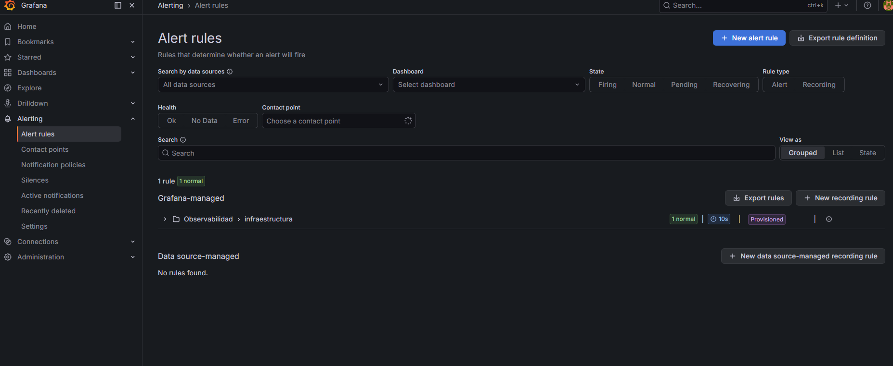

# Regla normal de CPU observada en Grafana — Windows

Capturas originales aportadas por Benja el 5 de noviembre de 2026, después de aprobar la integración completa.

La página de la regla muestra:

- Nombre `CPU alta · laboratorio`, estado Normal y evaluación cada 10 segundos.
- Consulta A: porcentaje medio no ocioso de CPU de Node Exporter sobre una ventana de 5 minutos.
- Valor de CPU mostrado: 1,20886 %.
- Reducción B: último valor de A; la interfaz muestra su modo predeterminado Strict.
- Condición C: `Is above 80`, evaluada como falsa (0) y en estado Normal.
- Etiquetas component=infraestructura, scope=docker-linux y severity=warning.
- Mensaje de provisioning: la regla procede de los archivos del proyecto.

La descripción visible menciona el minuto de permanencia. El campo de configuración `for` no aparece desplegado en esta captura; la integración de PowerShell sí verificó su restauración a 1 minuto, junto al umbral 80, antes de aprobar. Se distinguen la evaluación cada 10 segundos, la ventana de cálculo de 5 minutos y el minuto durante el que debe mantenerse la condición.

La vista general también muestra una regla Normal, un grupo provisionado y frecuencia de evaluación de 10 segundos:

La captura del receptor Webhook también se incorporó: pr04-webhook-windows.png y pr04-webhook-resolved-windows.png.
