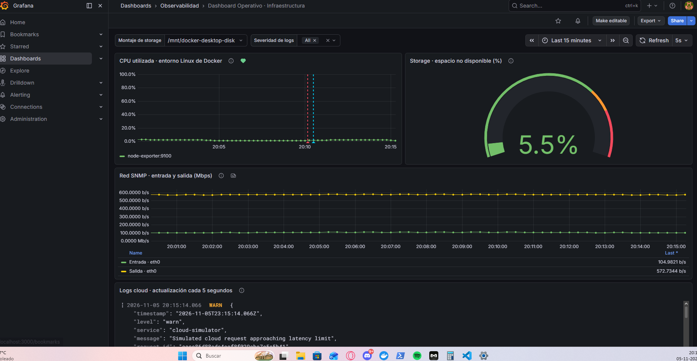

# Dashboard Operativo observado en Windows

Captura original aportada por Benja el 5 de noviembre de 2026, después de aprobar la integración completa del stack.

La imagen muestra el Dashboard Operativo de Infraestructura con:

- Montaje de storage seleccionado: `/mnt/docker-desktop-disk`.
- Panel de CPU con datos de `node-exporter:9100` y anotaciones de alerta.
- Gauge de storage: 5,5 % de espacio no disponible, según la fórmula del panel. No se atribuye al disco C: de Windows.
- Series SNMP de entrada y salida para eth0, con muestras continuas.
- Panel Loki con eventos JSON del servicio cloud-simulator y severidad WARN visible.
- Actualización automática del dashboard cada 5 segundos.

La consulta de red convierte los contadores a Mbps; la captura presenta una escala automática de bits por segundo para este tráfico pequeño. No se interpreta como una medición de gran capacidad de red.

Esta captura valida la presentación conjunta de las cuatro señales del dashboard. Las capturas de la regla normal y del receptor Webhook también se incorporaron; ver PR04_VALIDACION.md en el directorio superior.
