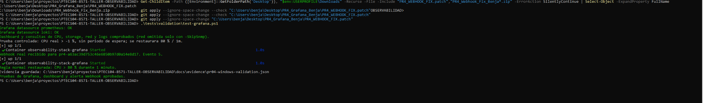

# Validación real de Grafana y Webhook en Windows

Fecha de observación: 5 de noviembre de 2026. Evidencia aportada por Benja tras aplicar `PR4_WEBHOOK_FIX.patch`.

Comando mostrado en la captura:

```powershell
.\tests\validation\test-grafana.ps1
```

Resultados visibles:

- Fuentes Prometheus y Loki: OK.
- Dashboard y consultas de CPU, storage, red y logs: comprobados.
- La prueba controlada utilizó CPU real con umbral temporal -1 %.
- El receptor recibió un Webhook real para el identificador de esta ejecución (evento 5).
- La regla normal fue restaurada: CPU > 80 % durante 1 minuto.
- El script informó `Pruebas de Grafana, dashboard y alerta Webhook aprobadas.`.
- El script guardó `docs/evidence/pr04-windows-validation.json` en el equipo del estudiante. Sus bytes todavía no se han proporcionado aquí; este registro no los sustituye.



Alcance: se valida la ejecución independiente de test-grafana.ps1 después de la corrección. La integración completa con dev.ps1 y las capturas del dashboard, la regla y el receptor se incorporaron posteriormente. Este registro conserva el alcance de la prueba independiente.
