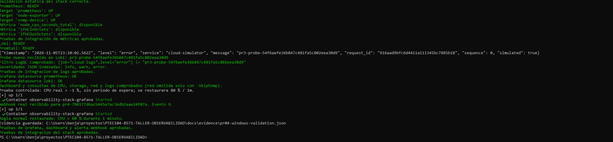

# Integración completa del PR #4 en Windows

Fecha de observación: 5 de noviembre de 2026. Captura real aportada por Benja después de corregir la lectura UTF-8 y el reconocimiento del Webhook por UID.

Procedimiento solicitado y resultado presentado:

```powershell
.\dev.ps1 test -Integration
```

Resultados visibles en la captura:

- Validación estática del stack correcta.
- Prometheus READY y targets prometheus, node-exporter y snmp-device UP.
- Métricas node_cpu_seconds_total, ifHCInOctets e ifHCOutOctets disponibles; integración de métricas aprobada.
- Loki y Promtail READY; un probe nuevo del generador llegó a Loki con level=error y fue localizado por LogQL.
- Severidades JSON info, warn y error indexadas; integración de logs aprobada.
- Fuentes Prometheus y Loki de Grafana OK; dashboard y consultas de CPU, storage, red y logs comprobados.
- Grafana envió un Webhook real para la ejecución controlada, recibido como evento 9.
- La regla normal fue restaurada: CPU > 80 % durante 1 minuto.
- Resultado final: `Pruebas de integracion del stack aprobadas.`.



El script guardó `docs/evidence/pr04-windows-validation.json` en el PC de Benja. El archivo no se ha adjuntado aquí; este registro documenta lo visible en la captura y no inventa sus valores internos.

La evidencia demuestra la integración funcional del alcance hasta PR #4. Las capturas posteriores del Dashboard Operativo, la regla normal y el receptor ya completan la documentación visual del PR #4. Las trazas de Jaeger y OpenTelemetry corresponden al PR #5.
