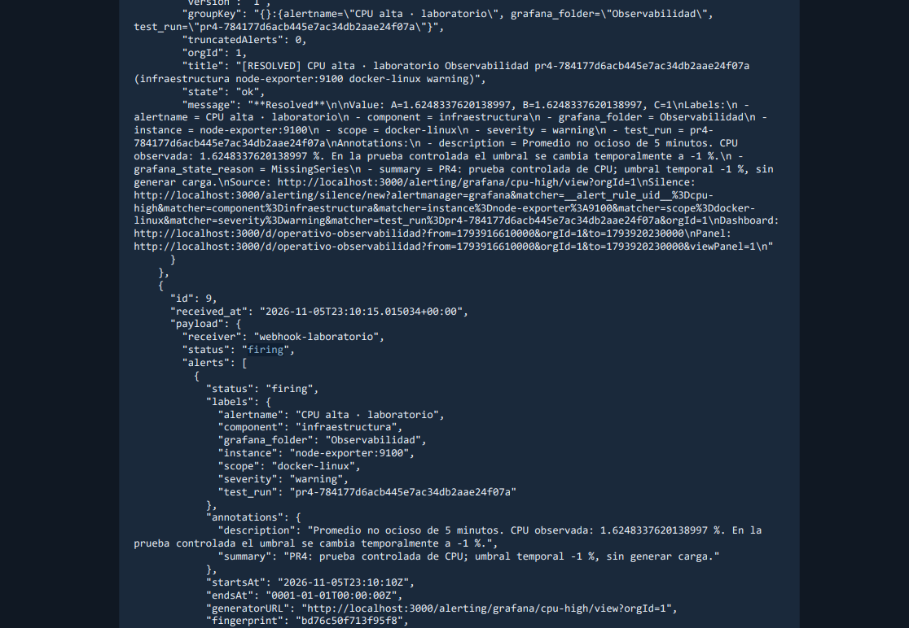
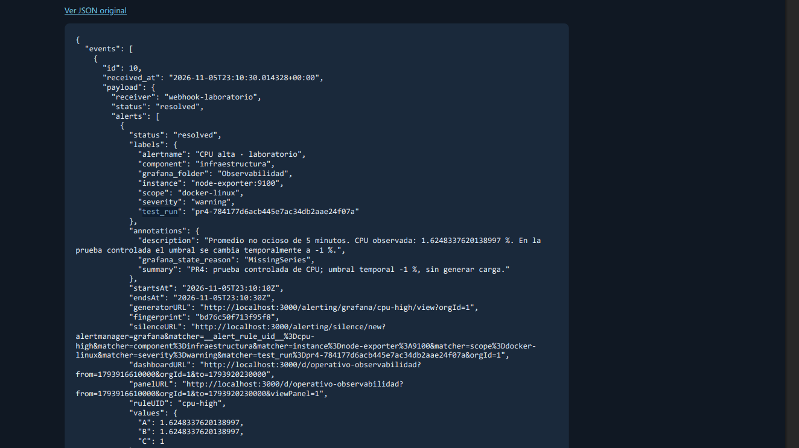

# Avisos Webhook observados en Windows

Capturas originales aportadas por Benja el 5 de noviembre de 2026, después de aprobar la integración completa del stack.

| Dato visible | Aviso de activación | Aviso posterior |
|---|---|---|
| Evento del receptor | 9 | 10 |
| Estado | firing | resolved |
| Recepción (UTC) | 2026-11-05T23:10:15.015034+00:00 | 2026-11-05T23:10:30.014328+00:00 |
| Identificador de prueba | pr4-784177d6acb445e7ac34db2aae24f07a | El mismo identificador |
| Regla | CPU alta · laboratorio | CPU alta · laboratorio; ruleUID cpu-high visible |
| CPU registrada | Aproximadamente 1,6248 % | El mismo valor conservado en el aviso |

La anotación de ambos avisos identifica una **prueba controlada con umbral temporal -1 %**, sin generar carga adicional. No es evidencia de que la CPU superase 80 % durante un minuto.

El aviso resolved contiene `grafana_state_reason: MissingSeries`. Al finalizar la prueba, el script retira la etiqueta temporal y restaura la regla normal. El motivo observado es compatible con retirar esa serie de prueba; no se interpreta como una medición de descenso de CPU. La restauración a 80 % / 1 minuto fue comprobada por separado por el script y la regla aparece Normal en Grafana.

Las capturas confirman activación y aviso posterior para la misma ejecución. El receptor y sus registros son reales; el destino es una simulación local de un sistema de notificaciones externo.
